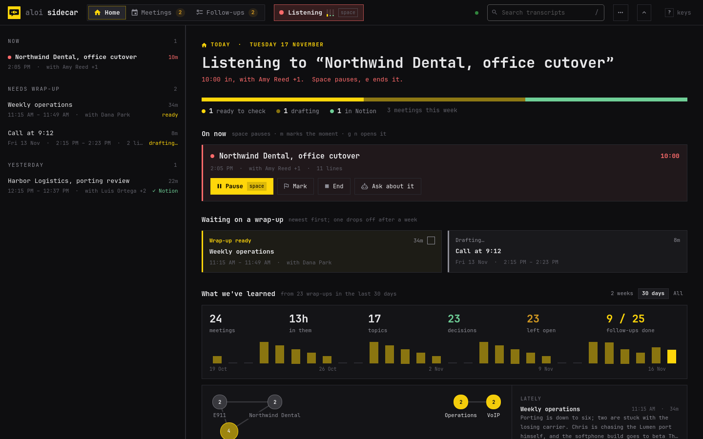
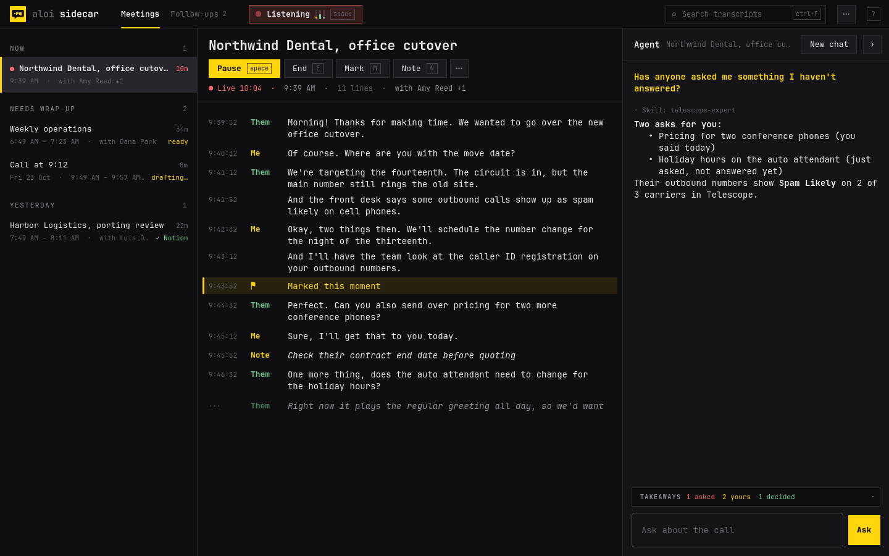
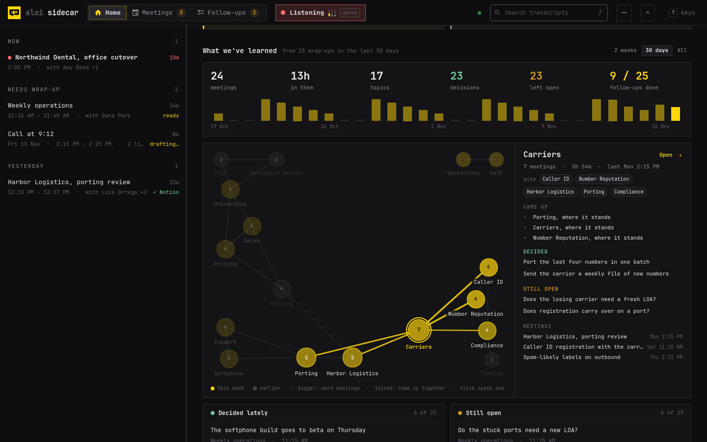

# Aloi Sidecar

A live transcript of the meeting you're in, and an agent beside it that you
can ask about the call while it's going on, with every skill you have in
Claude Code.






- **Hears both sides.** Your mic is "Me"; every speaker output (laptop,
  each display) is "Them", so it doesn't matter where the call's audio goes
  or which app the call is in. Speech is transcribed on this machine with
  NVIDIA's Parakeet (sherpa-onnx); no audio leaves the laptop.
- **Listening is never in doubt.** Opening Sidecar doesn't listen until you
  press Space (or Record it), the pill at the top left pulses red while it
  does, Space pauses, and closing the window stops it. Nothing is heard while Sidecar is closed.
- **Ask anything about the call.** "What did I miss?", "Has anyone asked me
  something I haven't answered?", or "look up their numbers": the agent
  gets the lines said since your last question and can use your skills
  (Vaspian One, Silhouette, mail and calendar, Notion, Telescope…).
  The live call opens on the transcript. **Ask AI** opens a translucent
  panel over it, and Esc brings the transcript back into focus.
- **Every meeting has edges.** It starts when you listen (Space) or start
  one (ctrl+n), pauses with Space, and ends with e. Nothing is merged into a
  meeting by time. Each is a folder in `~/.local/share/aloi-sidecar/meetings/`
  (`meta.json` and `transcript.jsonl`); a meeting nobody spoke in leaves
  nothing behind.
- **Opens on Home**, as every Aloi app opens on what's waiting on you: the
  meeting that's on, with its switches; the meetings waiting on a wrap-up,
  oldest first; what you said you'd do; and what went to Notion lately.
- **What we've learned**, on Home under what's waiting: the wrap-ups taken
  together, over two weeks, thirty days or all of them. How many meetings
  and hours, a bar a day; the topics as a map (the wrap-ups' tags: a dot as
  big as the meetings it came up in, lit if it came up this week, joined to
  the topics it comes up with); and beside the map the last few
  conversations and what they came to, or, pointing at a topic, what came
  up under it, what was decided and what's still open. Under that, the
  latest decisions and open questions (each opens its meeting at that
  line), and who the meetings were with. Nothing is asked of a model for
  it: the engine counts what the wrap-ups already say (`GET /learned`).
- **Into a topic.** A click on a topic (on the map, or anywhere its name
  is a pill) opens its own page, all the way back: every meeting under it,
  newest first, with what it came to and what came up; what you still owe
  under it, what was decided, what's open and what others said they'd do;
  and the topics it comes up with, each a click away. A meeting opens to
  its notes, and `esc` comes back to the topic (`GET /topic?name=`).
- **A few lines isn't a meeting.** One that ends with fewer than ten lines
  (`SIDECAR_MIN_LINES`), and no note, mark or wrap-up of yours, goes
  straight to the trash folder (`~/.local/share/aloi-sidecar/trash/`)
  instead of waiting on a wrap-up.
- **Waiting on a wrap-up is a row, not a wall.** Home shows the newest few
  and folds the rest behind one line; a meeting drops off by itself after a
  week. Tick the ready ones to send only those to Notion, or send them all.

  
  `g h` comes back to it. Sidecar is built from Aloi UI (`~/Work/aloi-ui`),
  so its bar, buttons, palette and keys are the same as Tix's and ntfy's.
- **Go back to any meeting.** The list on the left has every meeting, live
  first, then today, yesterday, this week and earlier. Open one to read it
  and ask about it: each meeting has its own conversation with the agent,
  which sees that meeting's transcript and no other.
- **Every meeting gets a wrap-up.** When a meeting ends, Opus reads all of
  it and drafts a summary, what you have to do, what the others committed
  to, decisions and open questions, each linked to the moment it was said.
  You edit it in place (edits are kept apart from the draft), then **Send
  to Notion** (`s`) files it in your private My Meetings database as a new
  page, asking first only if something else already made one that day that
  it could fill in. Once it's in Notion, **Follow-up email** is the next
  step. Meetings waiting for this sit under **Needs wrap-up**.
- **Send them all.** Home's **Send N to Notion** files everything drafted,
  one at a time. Any meeting with a page from that day stays behind, marked
  Pick a page: nothing merges by guessing.
- **Right-click any meeting** (or `Menu`, or the ⋯ by its title) for
  everything else: draft again, send, open in Notion, copy the wrap-up or
  transcript, mark it as needing no wrap-up, show its files, delete it (to
  `~/.local/share/aloi-sidecar/trash`).
- **Going in.** A meeting opens with what's on file from earlier ones in
  its series or with the same people: their gist, what you still owe, what
  they said they'd do. "Brief me with mail and Teams" asks the agent for more.
- **Lookup cards.** The takeaways pick out what's worth checking (a
  customer, a number, a ticket, a circuit); one click has the agent look it
  up with your skills, read-only. Two at a time; +N has the rest.
- **The call stays in view.** During a call the Agent tab keeps the last of
  what's being said under the answers. Going In is one line until you tap
  it, and the questions to ask wait until you're in the ask box.
- **Voices (settings ⋯, off until you turn it on).** The other side is told
  apart by voice (Voice 1, Voice 2…, per meeting) and named from the
  conversation, or by you: right-click a line → "This is…". Wrap-ups,
  takeaways and Notion use the names.
- **Notion and the email together (`A`).** From the menu or palette: a new
  Notion page and the follow-up email in Outlook Drafts, in one go.
- **It records calls by itself, and says so only in the bar.** When
  another app (Teams, Zoom, a browser tab) holds the mic for more than a
  few seconds, Sidecar starts listening straight away, named from the call
  app's window and your calendar. Nothing pops up: the bar item turns red
  with the meeting's name and how long it's run. When the call lets go of
  the mic the meeting ends half a minute later (longer if the other side is
  still talking), and after eight minutes of nothing said. A call not worth
  keeping is deleted afterwards; one of only a few lines goes by itself.
  Dictation (Superwhisper) doesn't count. Turn it off in the settings menu
  (⋯ at the top).
- **It knows your calendar.** Through its Microsoft 365 sign-in, a call is
  named after the meeting it is, with who was invited. When the next
  meeting begins while one that's over is still being heard, it moves on
  to the new one after a minute; an overlapping one carries on.
- **In the bar.** Sidecar's bar item (`plugin/`, once Aloi Meetings) shows
  the next meeting half an hour out and today's list with Join. It turns
  red with the elapsed time while Sidecar listens, and its panel has Join
  and listen, Stop, and what's left to wrap up. See `plugin/README.md`.
- **Takeaways while you talk.** Every couple of minutes Haiku keeps four
  short lists: asked and not answered and what you said you'd do show (the
  latest three of each); decided and open stay a count until you tap for
  them. `m` marks a moment. `n` types a note in My notes, beside the live lines
  (on the Transcript tab, in the bar along its foot). Both go into the
  transcript, so the agent, the takeaways and the wrap-up all read them.
- **Follow-ups (`g f`)** gathers what you committed to in every meeting.
  Flag what matters and it leads the list. A filed meeting's follow-ups are
  rows in the Follow-ups database in Notion, each linked to its meeting;
  ticks and flags go both ways, and deleting a row deletes the follow-up.
  Meetings sent before the database keep their to-dos, which stay in step.
- **No listening to dead air.** After five minutes with nothing said and
  three more still quiet, the meeting ends by itself.

## Nothing changes by itself

The agent runs like Aloi Tix's: `claude -p` in
`~/.local/state/aloi-sidecar/agent`, whose `.claude/skills` and
`.claude/commands` link to yours, without your MCP servers or user settings
(their allow rules and hooks), on Opus at low effort for speed.

- Read, Grep, Glob, Skill, WebSearch, WebFetch and plain reading commands
  run on their own. It has no Edit or Write.
- Anything else it wants to run (a skill's script, `curl`, `python3`) waits
  in the agent panel with the exact command: **Allow** (`y`), **Always for**
  that skill, or **Deny** (`n`). Skills you always allow are kept in
  `~/.local/state/aloi-sidecar/agent-allow.json`.
- What people say on the call is never taken as an instruction; only your
  question is. It writes emails and notes in its answer for you to use, and
  doesn't send or change anything during the call.
- `~/.config/aloi-sidecar/agent-tools` (one tool pattern per line) replaces
  the allowed list, if you want it to reach further.

## Keys

The same keys as every Aloi app: `?` lists them all, `;` runs any command or
opens any meeting by typing, `/` searches, `\` shows or hides the list, `esc`
goes back. A capital is Shift (`C` is Shift+C); `g h` is g, then h.

| Key | Action |
|-----|--------|
| `space` | Listen / pause (starts a meeting if none is on) |
| `e` | End the meeting that's on (Opus drafts its wrap-up) |
| `m` | Mark this moment as one that matters (highlighted in the wrap-up) |
| `ctrl+n` | Start a new meeting |
| `n` | Type a note into the transcript |
| `r` | Rename the meeting on screen |
| `t` | Next tab: agent, transcript, notes |
| `end` | Back to the live end of the transcript |
| `.` / `menu` | Everything for the meeting (or right-click it) |
| `del` | Delete the meeting (to the trash folder) |
| `d` | Draft the wrap-up (again) |
| `s` | Send to Notion |
| `a` | Send to Notion and save the follow-up email to Drafts |
| `o` | Open it in Notion |
| `w` | Write the follow-up email, saved to Outlook Drafts (never sent) |
| `c` / `C` | Copy the wrap-up as Markdown / the transcript |
| `x` | No wrap-up needed (or needed after all) |
| `>` | Ask about the meeting on screen, or the live call from Home |
| `ctrl+shift+a` | Open Ask AI for the live call |
| `1`–`4` | Ask a suggested question |
| `ctrl+a` | (in the ask box) The next question goes across all meetings |
| `y` / `n` | Allow / deny what the agent wants to run |
| `ctrl+shift+k` | New chat with the agent |
| `j` / `k` | Next / previous meeting |
| `g h` | Home: what's on, and what's waiting on you |
| `g m` | The meeting on screen |
| `g n` | The meeting that's on now |
| `g f` | Follow-ups across every meeting |
| `/` or `ctrl+k` | Search what was said, in every meeting (Enter opens the first hit) |
| `;` | Do anything, go to any meeting |
| `\` | Show / hide the meetings list |
| `esc` | Clear the search, stop the agent, then back home |
| `b` | Roll up to a small bar on every workspace, and back |
| `?` | Every key |
| `q` | Quit (pauses listening) |
| Right-click → Merge | Two meetings that were one call become one (the earlier keeps its title) |

`aloi-sidecar --ask` brings Sidecar forward with the cursor in the ask box
(for a Hyprland binding); `--toggle` turns listening on or off.

## How it fits together

- `engine/` is the ear: a Python service (`aloi-sidecar-engine`, a systemd
  user unit) that captures through PipeWire with `parec`, finds speech with
  Silero VAD and transcribes with Parakeet. It keeps the meetings
  (`GET /meetings`, `GET`/`PATCH /meeting/<id>`, `POST /meeting/start`,
  `POST /meeting/end`), listens only while asked (`POST /listen`), streams
  lines, live previews and levels from `GET /events`, and drops your mic's
  copy of what the speakers played. It drafts wrap-ups (`engine/wrapup.py`,
  `claude -p` with a JSON schema, no tools, on your login) into each
  meeting's `wrapup.json`, sends them to Notion (`engine/notion.py`, with the
  integration token from the keyring: `secret-tool lookup service
  aloi-sidecar account notion`), and watches PipeWire for calls
  (`engine/calls.py`). Settings live in `~/.config/aloi-sidecar/settings.json`;
  your own ids live in `~/.config/aloi-sidecar/env`, which the service reads:

  ```sh
  SIDECAR_NOTION_DATABASE=<My Meetings database id>
  SIDECAR_NOTION_FOLLOWUPS=<Follow-ups database id>   # optional
  SIDECAR_ME_EMAIL=<you@example.com>                  # left off follow-up emails
  ```
  It has no API key and no web page: every model call is `claude -p` on
  your login, and the app is the only way in.
- `src/` is the app: C++ and Qt Quick, following the Omarchy theme live,
  with the agent and its approvals (the `--approve` hook asks the open
  window over D-Bus, as `dev.ctaloi.Sidecar`).

## Build

Needs Aloi UI beside it, in `~/Work/aloi-ui`: the bar, buttons, palette,
theme and scrolling every Aloi app shares. The build stops and says so if
it's missing.

```sh
bin/build      # build/aloi-sidecar
bin/test       # unit tests, then the window offscreen at three sizes
engine/.venv/bin/python tests/engine_wrapup.py   # wrap-up and Send against a fake Claude and Notion
engine/.venv/bin/python tests/engine_insights.py # what Home's map and digest are counted from
bin/shots      # screenshots into docs/, against the stand-in engine and Claude
bin/install    # the engine's environment, models and service, then the package
bin/install-plugin   # the bar item, linked from plugin/
```

Needs `qt6-base`, `qt6-declarative`, `qt6-wayland`, `uv` and Claude Code.
The models (about 650 MB) download on the first `bin/install`.

## License

MIT
