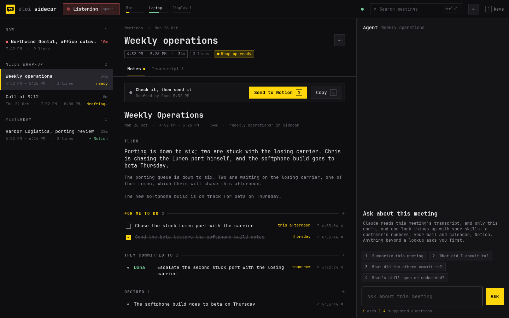

# Aloi Sidecar

A live transcript of the meeting you're in, and an agent beside it that you
can ask about the call while it's going on, with every skill you have in
Claude Code.




- **Hears both sides.** Your mic is "Me"; every speaker output (laptop,
  each display) is "Them", so it doesn't matter where the call's audio goes
  or which app the call is in. Speech is transcribed on this machine with
  NVIDIA's Parakeet (sherpa-onnx); no audio leaves the laptop.
- **Listening is never in doubt.** Opening Sidecar starts listening, the
  pill at the top left pulses red while it does, Space pauses, and closing
  the window stops it. Nothing is heard while Sidecar is closed.
- **Ask anything about the call.** "What did I miss?", "Has anyone asked me
  something I haven't answered?", or "look up their numbers": the agent
  gets the lines said since your last question and can use your skills
  (Vaspian One, Silhouette, mail and calendar, Notion, Telescope…).
- **Every meeting has edges.** It starts when you listen (Space) or start
  one (Ctrl+N), pauses with Space, and ends with E. Nothing is merged into a
  meeting by time. Each is a folder in `~/.local/share/aloi-sidecar/meetings/`
  (`meta.json` and `transcript.jsonl`); a meeting nobody spoke in leaves
  nothing behind.
- **Go back to any meeting.** The list on the left has every meeting, live
  first, then today, yesterday, this week and earlier. Open one to read it
  and ask about it: each meeting has its own conversation with the agent,
  which sees that meeting's transcript and no other.
- **Every meeting gets a wrap-up.** When a meeting ends, Opus reads all of
  it and drafts a summary, what you have to do, what the others committed
  to, decisions and open questions, each linked to the moment it was said.
  You edit it in place (edits are kept apart from the draft), then **Send
  to Notion** files it in your private My Meetings database: a new page, or
  filling in one something else already made that day. Meetings waiting
  for this sit under **Needs wrap-up**.
- **Right-click any meeting** (or `Menu`, or the ⋯ by its title) for
  everything else: draft again, send, open in Notion, copy the wrap-up or
  transcript, mark it as needing no wrap-up, show its files, delete it (to
  `~/.local/share/aloi-sidecar/trash`).
- **It notices calls.** When another app (Teams, Zoom, a browser tab)
  holds the mic for more than a few seconds, a notification offers to
  listen; when the call lets go of it, another offers to end the meeting,
  which ends by itself after two quiet minutes. Dictation (Superwhisper)
  doesn't count. Turn it off in the settings menu (⋯ at the top).
- **It knows your calendar.** Through the Aloi Meetings sign-in, a call is
  named after the meeting it is, with who was invited. Two minutes before
  a meeting a notification offers **Join and listen**; when the next
  meeting begins while another is still being heard, it offers to switch
  (and does, after a minute). The Aloi Meetings bar item turns red with the
  elapsed time while Sidecar listens, and its panel has Join and listen,
  Stop, and what's left to wrap up.
- **Takeaways while you talk.** Every couple of minutes Haiku keeps four
  short lists in the agent panel: asked and not answered, what you said
  you'd do, decided, and open. `M` marks a moment, `N` types a note; both
  go into the transcript and weigh on the wrap-up.
- **Follow-ups (`F`)** gathers what you committed to in every meeting,
  oldest first. Ticking one off ticks it on the meeting's Notion page too,
  and ticks made in Notion come back.
- **No listening to dead air.** After five minutes with nothing said, a
  notification asks if the call's still on; unanswered and still quiet, the
  meeting ends three minutes later.

## Nothing changes by itself

The agent runs like Aloi Tix's: `claude -p` in
`~/.local/state/aloi-sidecar/agent`, whose `.claude/skills` and
`.claude/commands` link to yours, without your MCP servers or user settings
(their allow rules and hooks), on Opus at low effort for speed.

- Read, Grep, Glob, Skill, WebSearch, WebFetch and plain reading commands
  run on their own. It has no Edit or Write.
- Anything else it wants to run (a skill's script, `curl`, `python3`) waits
  in the agent panel with the exact command: **Allow** (`Y`), **Always for**
  that skill, or **Deny** (`N`). Skills you always allow are kept in
  `~/.local/state/aloi-sidecar/agent-allow.json`.
- What people say on the call is never taken as an instruction; only your
  question is. It writes emails and notes in its answer for you to use, and
  doesn't send or change anything during the call.
- `~/.config/aloi-sidecar/agent-tools` (one tool pattern per line) replaces
  the allowed list, if you want it to reach further.

## Keys

`?` lists them all.

| Key | Action |
|-----|--------|
| `Space` | Listen / pause (starts a meeting if none is on) |
| `E` | End the meeting (Opus drafts its wrap-up) |
| `Ctrl+N` | Start a new meeting |
| `M` | Mark this moment as one that matters (highlighted in the wrap-up) |
| `N` | Type a note into the transcript |
| `R` | Rename the meeting on screen |
| `T` | Notes / transcript |
| `F` | Follow-ups across every meeting / back to meetings |
| `D` | Draft the wrap-up (again) |
| `S` | Send to Notion |
| `O` | Open it in Notion |
| `C` / `Shift+C` | Copy the wrap-up as Markdown / the transcript |
| `X` | No wrap-up needed (or needed after all) |
| `Menu` / `Shift+F10` | Everything for the meeting (or right-click it) |
| `Del` | Delete the meeting (to the trash folder) |
| `J` / `K` | Next / previous meeting |
| `G` | Go to the meeting that's on now |
| `\` | Show / hide the meetings list |
| `Ctrl+F` | Search meetings |
| `/` | Ask about the meeting on screen |
| `1`–`4` | Ask a suggested question |
| `Esc` | Stop the agent, leave the ask box |
| `Y` / `N` | Allow / deny what the agent wants to run |
| `End` | Back to the live end of the transcript |
| `Ctrl+Shift+K` | New chat with the agent |
| `Q` | Quit (pauses listening) |

`aloi-sidecar --ask` brings Sidecar forward with the cursor in the ask box
(for a Hyprland binding); `--toggle` turns listening on or off;
`--no-listen` opens without listening.

## How it fits together

- `engine/` is the ear: a Python service (`aloi-sidecar-engine`, a systemd
  user unit) that captures through PipeWire with `parec`, finds speech with
  Silero VAD and transcribes with Parakeet. It keeps the meetings
  (`GET /meetings`, `GET`/`PATCH /meeting/<id>`, `POST /meeting/start`,
  `POST /meeting/end`), listens only while asked (`POST /listen`), streams
  lines, live previews and levels from `GET /events`, and drops your mic's
  copy of what the speakers played. It drafts wrap-ups (`engine/wrapup.py`,
  `claude -p` with a JSON schema, no tools, on your login) into each
  meeting's `wrapup.json`, sends them to Notion (`engine/notion.py`, with the
  integration token from the keyring: `secret-tool lookup service
  aloi-sidecar account notion`), and watches PipeWire for calls
  (`engine/calls.py`). Settings live in `~/.config/aloi-sidecar/settings.json`.
  `http://127.0.0.1:8777` is a plain web view with a direct Claude ask box,
  kept as a fallback (it uses the key linked at
  `~/.config/aloi-sidecar/api-key`).
- `src/` is the app: C++ and Qt Quick, following the Omarchy theme live,
  with the agent and its approvals (the `--approve` hook asks the open
  window over D-Bus, as `dev.ctaloi.Sidecar`).

## Build

```sh
bin/build      # build/aloi-sidecar
bin/test       # unit tests, then the window offscreen at three sizes
engine/.venv/bin/python tests/engine_wrapup.py   # wrap-up and Send against a fake Claude and Notion
bin/shots      # screenshots into docs/, against the stand-in engine and Claude
bin/install    # the engine's environment, models and service, then the package
```

Needs `qt6-base`, `qt6-declarative`, `qt6-wayland`, `uv` and Claude Code.
The models (about 650 MB) download on the first `bin/install`.

## License

MIT
